# Awesome-Customer-Feedback-NPS-Software

  
  
  
  

  

<h3 align="center">🎯 Top Customer Feedback, Net Promoter Score (NPS) &amp; CX Software (Open-Source &amp; SaaS) 🌟 Star if you find it helpful! 🌟</h3>

  <b>A comprehensive curated directory of SaaS platforms, self-hosted survey engines, in-app micro-survey SDKs, and open-source feedback boards.</b>

  <em>Focused on NPS Collection, In-App Micro-Surveys, Research-Grade Questionnaires, AI Sentiment Insights &amp; Self-Hosted Feedback Platforms</em> 
  <b>Last updated: November 2026</b>

---

## 🧭 Table of Contents

- [📊 Sector Overview &amp; Market Dynamics](#-sector-overview--market-dynamics)
- [☁️ SaaS &amp; Commercial Hosted Platforms](#️-saas--commercial-hosted-platforms)
- [🔓 Open-Source GitHub Projects](#-open-source-github-projects)
- [🛠️ How to Contribute](#️-how-to-contribute)
- [⚖️ Disclaimer &amp; Architecture Guidance](#️-disclaimer--architecture-guidance)
- [⭐ Star History](#-star-history)
- [💖 Support &amp; Sponsorship](#-support--sponsorship)

---

## 📊 Sector Overview &amp; Market Dynamics

The global **Customer Experience Management (CEM / CXM)** software market is valued at approximately **$14.0B to $17.5B** (with the specialized customer feedback and Voice of Customer software sub-segment reaching **$2.5B+**) and is expanding at an annualized CAGR of **11% to 15%** driven by generative AI sentiment analysis and automated in-app orchestration. The sector displays **moderate-to-high fragmentation** at the application tier—bifurcated between an enterprise oligopoly (Qualtrics, Medallia, and HubSpot) capturing centralized multi-million dollar CX contracts, and a highly competitive, fast-moving long tail of product-led in-app micro-survey tools, conversational form builders, and open-source self-hosted alternatives preventing a winner-take-all monopoly.

---

## ☁️ SaaS &amp; Commercial Hosted Platforms

| Rank | Platform | Valuation / Revenue Scale | Starting Pricing | Free Tier / Trial Limit | Key Focus &amp; Best For |
| :---: | :--- | :--- | :--- | :--- | :--- |
| 1 | **[HubSpot Service Hub](https://www.hubspot.com/)** | **~$12.0B Market Cap** (NYSE: HUBS) / ~$2.2B ARR | **$15/seat/month** (Starter, billed annually) or $20/mo monthly | **Free-forever tier** (Max 2 seats, basic ticketing, shared inbox &amp; live chat; NPS/CSAT requires Pro tier $90–$100/seat/mo) | Complete CRM + omnichannel ticketing and automated satisfaction surveys for teams already centered on HubSpot. |
| 2 | **[Qualtrics XM](https://www.qualtrics.com/)** | **$12.5B Valuation** (Acquired by Silver Lake / CPP) / ~$1.5B ARR | **$420/month** ($5,040/year billed annually) for Strategic Research; Enterprise CX custom (~$15k–$50k+/year) | **Free-forever account** (3 active surveys, 30 questions/survey, web/social links only, 500 lifetime total responses); **30-day trial** of Strategic Research tier | Enterprise-wide CX programs, academic rigor, employee experience (EX), and advanced statistical analytics. |
| 3 | **[Medallia](https://www.medallia.com/)** | **~$6.4B Peak Valuation** (Lender consortium buyout 2026) / ~$600M–$1B ARR | **Custom enterprise quote** (Contract floor typically starts at ~$25k–$50k+/year) | **No free tier**; **No self-serve free trial** (Sales evaluation demo and custom proof-of-concept only) | Fortune 500 enterprises needing high-volume omnichannel feedback capture across contact centers, digital apps, and physical retail. |
| 4 | **[SurveyMonkey](https://www.surveymonkey.com/)** | **$1.5B Valuation** (Acquired by STG) / ~$480M ARR | **$25/month** (billed annually at $300/yr) or $39/mo for Individual Advantage; $30/user/mo Team | **Free-forever Basic plan** (10 questions per survey, 25 viewable responses per survey, unlimited total surveys) | Universal survey creation with pre-built NPS/CSAT templates for SMBs, market researchers, and ad-hoc projects. |
| 5 | **[Typeform](https://www.typeform.com/)** | **~$100M+ ARR** / Backed by $135M Series C | **$25/month** (billed annually at $300/yr) or $39/mo monthly for Basic Plan | **Free-forever plan** (10 responses/month, 10 questions per typeform, unlimited forms, basic logic jumps) | Engaging, conversational one-question-at-a-time forms that maximize completion rates for marketing and lead surveys. |
| 6 | **[InMoment](https://inmoment.com/)** | **~$100M–$170M ARR** (Private Equity backed) | **Custom quote** (Mid-market contracts start around ~$10k–$15k/year) | **No free tier**; **No self-serve free trial** (Guided solution demos arranged through sales consultation) | AI-powered Voice of Customer (VoC) text analytics and customer improvement workflows across distributed operations. |
| 7 | **[Sprig](https://sprig.com/)** | **~$20M–$25M ARR** / $88M+ Raised (Accel, a16z) | **$175/month** (billed annually, ~$2,100/yr) for Starter plan (up to 1,000 MTUs) | **Free-forever plan** (Capped at 500 Monthly Tracked Users and 1 active study per month); **14-day full feature trial** | Contextual in-product micro-surveys triggered by user events, integrated session replay, and AI feedback synthesis for product teams. |
| 8 | **[Retently](https://www.retently.com/)** | **~$1.7M ARR** (Private bootstrapped/SMB) | **$49/month** (Basic plan, billed annually) or $69/mo monthly | **No free tier**; **14-day free trial** with full platform capabilities (NPS, CSAT, CES, email &amp; web surveys) without credit card | Automated multi-channel NPS and CSAT collection with out-of-the-box Slack, HubSpot, and Zapier notifications. |
| 9 | **[Nicereply](https://www.nicereply.com/)** | **~$1.0M ARR** (Lean boutique SaaS) | **$39/month** (Mini plan, up to 100 responses/month, billed annually) or $49/mo monthly | **No free tier**; **14-day free trial** (Includes 100 survey responses, Zendesk/Front/Help Scout integrations) without credit card | Customer service and helpdesk support teams wanting one-click CSAT, CES, and NPS surveys directly inside ticket resolution emails. |
| 10 | **[Delighted](https://delighted.com/)** | *Historical $1M–$2M ARR (Subsidiary of Qualtrics; standalone sunset June 2026)* | **$19/month** (Historical Starter plan; migration to Qualtrics Core XM) | **Historical Free tier: 25 responses/month**; redirecting new accounts to Qualtrics XM free tier (500 lifetime responses) | Fast turnaround turn-key NPS surveys for product teams migrating into the Qualtrics ecosystem. |

---

## 🔓 Open-Source GitHub Projects

- **[Formbricks](https://github.com/formbricks/formbricks)** 

  **Open-source experience management platform** (AGPLv3) — **the premier open-source choice for in-product NPS and behavior-triggered micro-surveys**, with **13,000+ GitHub stars**. **Features**: **NPS, CSAT, CES, and 20+ question types**; **in-app surveys** triggered by user attributes, events, and segments; website surveys via lightweight JavaScript snippet; link surveys with custom branding; skip logic and conditional branching; built-in analytics with charts and CSV/JSON export; webhooks and integrations with Slack, Notion, Google Sheets, Airtable, and Zapier; multi-language support. **Tech stack**: Next.js, PostgreSQL (pgvector), Redis. **Deploy**: Self-hosted (Docker, Railway one-click) or Formbricks Cloud. **Trade-off**: **In-product focus**—less suited for long-form research questionnaires than LimeSurvey; enterprise features gated in paid tier. **Best for**: SaaS and product teams wanting contextual NPS that fires while users are in the app—not blast-one-link surveys.

- **[HeyForm](https://github.com/heyform/heyform)** 

  **Open-source conversational form and survey builder** (AGPLv3) — **a modern, self-hosted alternative to Typeform and SurveyMonkey**. **Features**: Interactive, conversational questionnaires, NPS ratings, multi-step forms, logic branching, integrations, and visual customization. **Tech stack**: Node.js, TypeScript, React, MongoDB. **Deploy**: Self-hosted (Docker) or HeyForm Cloud. **Trade-off**: Form builder orientation; requires external automation or webhooks for deep CRM workflows. **Best for**: teams wanting sleek, mobile-friendly conversational surveys and NPS collection without per-response limits.

- **[Fider](https://github.com/getfider/fider)** 

  **Open platform to collect, prioritize, and manage customer feedback** (AGPLv3) — **one of the most popular open-source feedback portal solutions**. **Features**: Public and private feedback boards, user voting, discussion threads, response status tags (planned, started, completed), custom branding, and social/OAuth login. **Tech stack**: Go, React, PostgreSQL. **Deploy**: Self-hosted (Docker) or Fider Cloud. **Trade-off**: **Feedback board and suggestion box**—does not calculate numeric NPS satisfaction metrics. **Best for**: product teams seeking a lightweight, transparent forum for feature requests and customer feedback.

- **[SurveyKing](https://github.com/javahuang/SurveyKing)** 

  **One-command deployable, full-featured survey engine** (MIT) — **powerful self-hosted alternative to SurveyMonkey**. **Features**: 20+ question types including NPS, scoring, ranking, exams, and logic rules; responsive design for mobile and desktop; comprehensive reporting and data export; granular permission management. **Tech stack**: Java, Spring Boot, Vue.js, MySQL/PostgreSQL. **Deploy**: Self-hosted (single Docker run command or jar). **Trade-off**: Full survey system rather than embedded SDK; traditional questionnaire layout. **Best for**: organizations wanting an enterprise-grade survey platform under an MIT license that deploys in seconds.

- **[Xiaoju Survey (XIAOJUSURVEY)](https://github.com/didi/xiaoju-survey)** 

  **Enterprise form builder and analytics platform developed by DiDi** (Apache-2.0) — **scalable survey and feedback infrastructure**. **Features**: Drag-and-drop question builder, flexible page logic, multiple question modules (NPS, matrices, ratings), collaborative survey editing, and rich visual data analysis dashboards. **Tech stack**: Node.js, NestJS, Vue 3, Element Plus, MongoDB. **Deploy**: Self-hosted (Docker Compose). **Trade-off**: Complex multi-service architecture suited for organizations. **Best for**: mid-to-large engineering teams looking for an enterprise-ready survey and questionnaire suite with rich visualization.

- **[LimeSurvey](https://github.com/LimeSurvey/LimeSurvey)** 

  **The world's #1 open-source survey platform** (GPLv2) — **the veteran research-grade survey engine**, around since 2006 and trusted by universities, governments, and market researchers. **Features**: **30+ question types** with deep logic, quotas, and branching; **900+ survey templates**; multilingual surveys (80+ languages); SPSS/R/STATA export; **NPS question type supported**; GDPR compliance; two-factor authentication; SAML/LDAP integration; active community and ecosystem. **Tech stack**: PHP, MySQL/MariaDB/PostgreSQL. **Deploy**: Self-hosted (Docker, manual) or LimeSurvey Cloud. **Trade-off**: **Utilitarian interface** compared to Formbricks; heavier for simple in-app NPS. **Best for**: research teams, academics, and organizations running long-form questionnaires where question logic and statistical exports matter.

- **[DWSurvey](https://github.com/wkeyuan/DWSurvey)** 

  **Comprehensive open-source survey and questionnaire platform** (AGPLv3) — **designed for enterprise survey workflows and data collection**. **Features**: Flexible questionnaire design, score calculations, conditional logic, multi-channel distribution (web, QR code, email), statistical reporting, and role-based permissions. **Tech stack**: Java, Spring Boot, Vue.js, MySQL. **Deploy**: Self-hosted (Docker / Tomcat / Spring Boot JAR). **Trade-off**: Traditional survey experience; requires Java backend environment. **Best for**: enterprise IT teams needing an internal, self-hosted questionnaire and assessment system.

- **[Astuto](https://github.com/astuto/astuto)** 

  **Open-source customer feedback tool** (AGPLv3) — **popular choice for public feedback boards with voting and prioritization**. **Features**: Collect, manage, and prioritize user feedback; public boards with upvoting; designed for product roadmap input; clean and responsive UI. **Tech stack**: Ruby on Rails, Vue.js, PostgreSQL. **Deploy**: Self-hosted (Docker). **Trade-off**: **Feedback board, not NPS**—no NPS scoring, no survey logic, no analytics. **Best for**: product teams wanting a public feedback portal where users vote on feature requests—not measuring satisfaction.

- **[Obsei](https://github.com/obsei/obsei)** 

  **Open-source, privacy-first Voice of Customer (VoC) analytics platform** (Apache-2.0) — **AI-powered sentiment analysis and feedback processing**. **Features**: Ingests customer feedback from multiple channels (app store reviews, social media, surveys, Zendesk); strips PII before AI processing; performs sentiment analysis, text classification, and categorization; syncs insights to Slack, Jira, or data warehouses. **Tech stack**: Python, FastAPI, Hugging Face, LLMs. **Deploy**: Self-hosted (Docker / Python package). **Trade-off**: **Analytics and aggregation engine, not a collection form**—ingests existing feedback data. **Best for**: CX and product teams looking to automate text feedback categorization, sentiment extraction, and privacy-first feedback intelligence.

- **[LogChimp](https://github.com/logchimp/logchimp)** 

  **Customer feedback tracking and product roadmap platform** (Apache-2.0) — **open-source alternative to Canny and Productboard**. **Features**: Capture user feedback, organize feedback into boards, prioritize features via user upvoting, roadmap tracking, and changelog updates. **Tech stack**: Node.js, Express, Vue.js, PostgreSQL. **Deploy**: Self-hosted (Docker). **Trade-off**: **Feedback management, not NPS surveys**—focuses on feature requests and roadmap alignment. **Best for**: startups and indie hackers wanting to align user feature requests with public roadmap visibility.

- **[Feedbase](https://github.com/chroxify/feedbase)** 

  **Modern customer feedback collection and changelog system** (AGPLv3) — **lightweight feedback portal**. **Features**: Public feedback boards, user votes and comments, release changelogs, privacy settings, and modern UI. **Tech stack**: TypeScript, Next.js, Tailwind CSS, PostgreSQL (Prisma). **Deploy**: Self-hosted (Docker / Vercel + Postgres). **Trade-off**: Feedback board focused; no quantitative NPS scoring engine. **Best for**: modern web apps and SaaS products looking for a stylish feedback and changelog tool.

- **[FormsLab](https://github.com/Ryczko/FormsLab)** 

  **Form builder for anonymous surveys, polls, and customer feedback** (MIT) — **experience management and polling platform**. **Features**: Anonymous response collection, flexible drag-and-drop form building, real-time analytics, charts, and data privacy controls. **Tech stack**: Go, TypeScript, React. **Deploy**: Self-hosted (Docker Compose). **Trade-off**: Lightweight tool; smaller community and integration ecosystem. **Best for**: teams needing privacy-preserving, anonymous user surveys with self-hosted simplicity.

- **[Wiredash](https://github.com/wiredashio/wiredash-sdk)** 

  **In-app user feedback and NPS SDK for Flutter apps** (Free / Open SDK) — **targeted feedback capture for cross-platform mobile apps**. **Features**: In-app NPS micro-surveys, visual bug reporting with annotated screenshots, contextual device metadata capture, and user feedback forms directly inside native mobile apps. **Tech stack**: Dart, Flutter. **Deploy**: Add package to Flutter app; integrates with Wiredash console. **Trade-off**: Flutter-specific client SDK; backend console has commercial cloud tiers. **Best for**: Flutter mobile developers wanting turnkey in-app NPS prompts and screenshot-annotated feedback.

- **[Volet](https://github.com/mydnic/volet)** 

  **Extensible customer feedback widget for Laravel applications** (MIT) — **simple in-app feedback slideout**. **Features**: Floating feedback button, screenshot capture, user rating/comment modal, customizable questions, and seamless Laravel database persistence. **Tech stack**: PHP, Laravel, Blade, JavaScript. **Deploy**: Composer package within Laravel projects. **Trade-off**: Framework-specific widget library; not a standalone SaaS or multi-platform dashboard. **Best for**: Laravel applications wanting an integrated in-app feedback popup without external third-party widgets.

- **[ABC User Feedback](https://github.com/line/abc-user-feedback)** 

  **Voice of Customer (VoC) feedback management platform by LINE** (Apache-2.0) — **standalone system for gathering and managing customer feedback**. **Features**: Multi-channel feedback aggregation, issue tagging and categorization, respondent tracking, search, and centralized VoC data organization. **Tech stack**: Java, Spring Boot, Vue.js, MySQL. **Deploy**: Self-hosted. **Trade-off**: Primarily internal VoC triage portal; requires custom integrations for frontline collection forms. **Best for**: support and CX teams managing high-volume incoming customer feedback across multiple touchpoints.

- **[Quackback](https://github.com/QuackbackIO/quackback)** 

  **Open-source alternative to Canny, UserVoice, and Productboard** (AGPLv3) — **customer feedback boards with SSO and embeddable widgets**. **Features**: Embeddable feedback widget, public board, voting, comments, status updates, user identification, and webhook alerts. **Tech stack**: TypeScript, Next.js, Tailwind CSS, PostgreSQL. **Deploy**: Self-hosted (Docker). **Trade-off**: Focused on feature prioritization; no survey logic or NPS index calculation. **Best for**: product-led growth companies wanting an embedded customer suggestion board.

- **[Refyyn](https://github.com/AbdullahSWE/Refyyn)** 

  **Self-hosted customer feedback tool with kanban roadmap and changelogs** (MIT) — **feedback-to-roadmap workflow**. **Features**: Admin dashboard for managing feedback; **public feedback board** with upvotes and comments; **public roadmap** (planned/in progress/completed); **changelog** for release notes; customizable boards and statuses. **Tech stack**: Laravel 12, Vue 3, Inertia.js, SQLite/MySQL/PostgreSQL. **Deploy**: Self-hosted (PHP 8.2+, Composer, Node 22+). **Trade-off**: **Feedback management, not NPS**—no survey scoring, no automated collection. **Best for**: product teams wanting feedback, roadmap, and changelog in one self-hosted tool.

- **[prometheus-nps](https://github.com/Zeb88/prometheus-nps)** 

  **NPS feedback system with AI analysis** (MIT) — **focused open-source NPS-specific implementation**. **Features**: **NPS feedback collection** (0-10 score + text); real-time NPS calculation; **AI-generated feedback summaries** via OpenAI; email integration for personalized form links; vector database storage (Supabase) for semantic search; CSV export; JWT authentication; rate limiting. **Tech stack**: Node.js, Express, Alpine.js, Supabase (PostgreSQL + pgvector), OpenAI, Resend. **Deploy**: Self-hosted (requires Supabase, OpenAI API key, Resend API key). **Trade-off**: **Early-stage project**—requires multiple external services (Supabase, OpenAI, Resend); not production-hardened. **Best for**: developers wanting a working NPS collection + AI analysis reference implementation.

- **[customersatisfactionmetrics](https://github.com/pescheckit/customersatisfactionmetrics)** 

  **Django package for customer satisfaction metrics** (MIT) — **reusable app for CSAT, NPS, CES, and generic surveys**. **Features**: Embedded survey models and views within Django apps; supports anonymous and authenticated user responses; metadata tracking; automatic calculation of NPS / CSAT / CES metrics. **Tech stack**: Python, Django. **Deploy**: Python package (pip install). **Trade-off**: Library/component, not a standalone platform; requires a parent Django project. **Best for**: Python/Django developers wanting to embed NPS or CSAT logic directly into their application backend.

- **[csat](https://github.com/ronpinkas/csat)** 

  **Self-contained CSAT survey and analytics in a single binary** (MIT) — **zero-dependency satisfaction survey tool**. **Features**: Encrypted SMS/email survey links, admin dashboard, multi-language support (English/Spanish), customizable branding, and single-file executable operation. **Tech stack**: Go. **Deploy**: Self-hosted (single compiled binary, no external DB required). **Trade-off**: **CSAT focused**—metric format is 1-5 customer satisfaction rather than standard 0-10 NPS. **Best for**: teams wanting an ultralight, single-binary feedback system for SMS or link-based satisfaction collection.

**💡 Frameworks &amp; Stack Recommendations**:
Combine **Formbricks** for in-app NPS with **Fider**, **Astuto**, or **Refyyn** for public feedback boards, **LimeSurvey** or **SurveyKing** for deep research questionnaires, and **Obsei** for AI-driven sentiment and Voice of Customer analytics—creating an end-to-end feedback ecosystem matched to every customer touchpoint.

---

## 🛠️ How to Contribute

Contributions are warmly encouraged! Help keep this directory current, accurate, and valuable for the open-source and CX community:

1. 🍴 Fork the repository.
2. 🌿 Create your feature branch (`git checkout -b feature/add-feedback-tool`).
3. 📝 Add/edit entries in `README.md` adhering to the existing formatting and neutral factual criteria:
   - For **Open-Source projects**: Include GitHub repo link, star badge (`style=social&color=white`), license, tech stack, deployment method, trade-offs, and best-for use cases.
   - For **SaaS platforms**: Include market size / valuation scale, specific starting tier pricing, and explicit free tier or trial duration limits in tabular format.
4. 🚀 Submit a PR with a concise description of the contribution.

---

## ⚖️ Disclaimer &amp; Architecture Guidance

- 📌 This repository is a **community-curated index** created for educational, architectural, and evaluation purposes; it does not constitute an official commercial endorsement.
- 🔐 **Data Privacy &amp; Compliance**: Customer feedback platforms process sensitive user sentiment and Personally Identifiable Information (PII). Ensure your selected deployment adheres to applicable regulations (**GDPR, CCPA/CPRA, HIPAA**) with strict data residency and role-based access control (RBAC).
- 🧩 **Architectural Distinction**:
  - **In-Product NPS &amp; Micro-Surveys** (*Formbricks, Sprig*): Embeds into web/mobile sessions, triggers contextually based on user events/attributes, minimizing respondent friction.
  - **Research-Grade Survey Suites** (*LimeSurvey, Qualtrics, SurveyKing*): Engineered for multi-page logic branching, statistical sampling, and complex questionnaires.
  - **Public Feedback Portals &amp; Roadmaps** (*Fider, Astuto, LogChimp, Refyyn*): Designed for user idea submission, community upvoting, and feature delivery transparency.
  - **Voice of Customer (VoC) Analytics** (*Obsei, InMoment*): Ingests unstructured multi-channel text feedback to extract sentiment, topics, and actionable insights.

---

## ⭐ Star History

---

## 💖 Support &amp; Sponsorship

Thank you so much for exploring and supporting **Awesome-Customer-Feedback-NPS-Software**! 🎉

If this repository saved you time, assisted your architectural evaluations, or inspired your customer experience stack:
- ⭐ **Star** this repository to help other developers and product managers discover it.
- 🍴 **Fork** and contribute back with updates and new tools.
- 📢 **Share** it with your engineering and product communities.
- ☕ **Buy a coffee or sponsor ongoing maintenance**: Your support keeps this project active and continuously updated!
  
👉 **[Sponsor on GitHub Sponsor Dashboard](https://github.com/sponsors/ishandutta2007)** 💖

---

  Made with ❤️ for product engineers, CX researchers, and data-driven teams building respondent-friendly feedback experiences worldwide. 🌍

